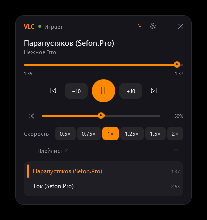
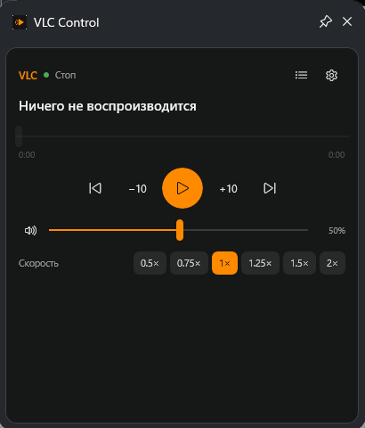
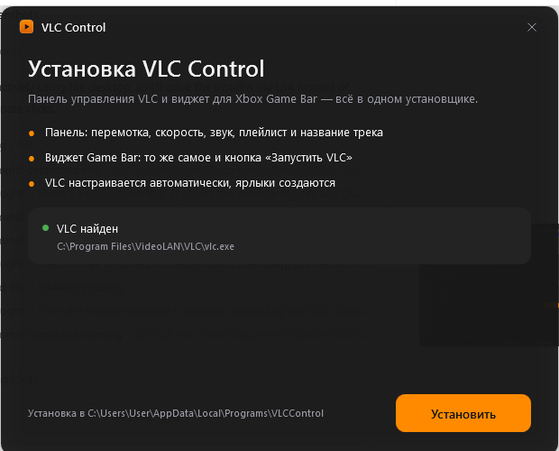
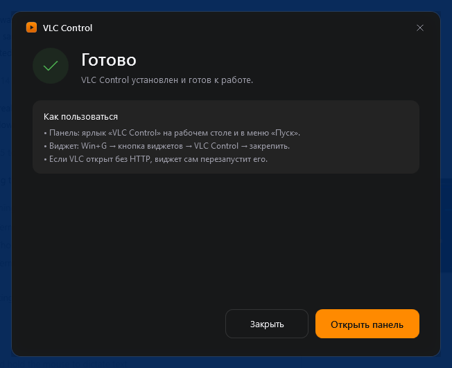

<p align="center">
  
</p>

# VLC Control

Управление VLC из **Xbox Game Bar** (`Win+G`) и из отдельной панели: скорость, перемотка, громкость, плейлист и название текущего трека. Один установщик настраивает всё сам — руками ничего вводить не нужно.

| Панель | Виджет Game Bar | Установщик |
| --- | --- | --- |
|  |  |  |

## Быстрый старт (3 шага)

1. **Скачай** `VLCControl-Setup.exe` из [релиза 1.0.0](https://github.com/bmarcnhii1-max/vlc-gamebar-widget/releases/tag/1.0.0).
2. **Запусти** его и нажми «Установить». Один запрос прав администратора — и всё: панель, виджет Game Bar, настройка HTTP-интерфейса VLC, ярлыки и запись в «Программы и компоненты».
3. **Открой** `Win+G` → иконка сетки виджетов → **VLC Control** → 📌 закрепить.

Готово: виджет появляется поверх игры, а панель доступна с ярлыка «VLC Control» на рабочем столе.


Установщик сам:

- распаковывает панель и виджет в `%LOCALAPPDATA%\Programs\VLCControl`;
- регистрирует пакет виджета (loose-регистрация через `Add-AppxPackage -Register`);
- включает режим разработчика, если он был выключен, и выдаёт loopback-исключение, чтобы UWP-виджет достучался до `127.0.0.1`;
- правит `%APPDATA%\vlc\vlcrc` (HTTP-интерфейс, хост `127.0.0.1`, порт `8080`, пароль `gamebar`) с **бэкапом** оригинала;
- создаёт ярлыки на рабочем столе и в меню «Пуск» и запись в «Программы и компоненты» для удаления.



## Что умеет

**Панель** (`VlcControl.exe`) — отдельное тёмное окно, всегда поверх остальных:

- название текущего трека, состояние, прогресс-бар с перемоткой кликом и перетаскиванием;
- ±10 секунд, предыдущий/следующий файл, пауза;
- громкость (слайдер) и mute с восстановлением прежнего уровня;
- скорость: 0.5×, 0.75×, 1×, 1.25×, 1.5×, 2×;
- плейлист с переходом на любой файл;
- кнопка «Запустить VLC» — если VLC не запущен или запущен без HTTP-интерфейса, он стартует/перезапускается с нужными настройками;
- настройки подключения (хост, порт, пароль) и проверка связи.

**Виджет Game Bar** — то же самое внутри оверлея игры, плюс кнопка «Запустить VLC».

Обе части общаются с VLC по документированному web-интерфейсу (`status.xml`, `playlist.xml`), поэтому работают и с VLC в фоне, и с полноэкранными играми.

## Требования

- Windows 10 версии 1903+ или Windows 11;
- Xbox Game Bar (входит в Windows, `Win+G`);
- VLC 3.x — если его нет, установщик всё равно поставит панель и виджет и предложит скачать VLC.

## Использование

| Элемент | Действие |
| --- | --- |
| Прогресс-бар | клик/драг — перемотка |
| ⟲10 / 10⟳ | −10 / +10 секунд |
| ⏮ / ⏭ | предыдущий / следующий файл плейлиста |
| Кружок в центре | пауза / воспроизведение |
| Слайдер с динамиком | громкость, клик по динамику — mute/unmute |
| Чипы `0.5×…2×` | скорость воспроизведения |
| Иконка списка | показать/скрыть плейлист |
| Шестерёнка | настройки подключения |

Ограничение Game Bar: виджет виден только в оверлее — поверх эксклюзивного полноэкранного режима игры он не рисуется. Используй «окно без рамки» или полноэкранный оптимизированный режим.

## Удаление

«Параметры → Приложения» → **VLC Control** → Удалить. Деинсталлятор снимает пакет виджета, loopback-исключение, ярлыки, запись о программе и возвращает режим разработчика в прежнее состояние.

## Решение проблем

| Симптом | Причина / решение |
| --- | --- |
| Виджет пишет «Нет связи» | VLC не запущен или запущен без HTTP; нажми «Запустить VLC» в виджете — он перезапустит VLC с нужными параметрами |
| Виджет не появился в меню Game Bar | Перезапусти Game Bar: `Stop-Process -Name GameBar,GameBarFTServer -Force; Start-Process ms-gamebar:` |
| Панель не видит VLC | Проверь настройки в шестерёнке: хост `127.0.0.1`, порт `8080`, пароль `gamebar` |
| Скорость/громкость не меняются | Некоторые кодеки не принимают команды `rate`/`volume` во время воспроизведения |
| Установщик не смог зарегистрировать виджет | Нужен режим разработчика: `Параметры → Система → Для разработчиков` (установщик включает его сам, если есть права) |

Логи: `%APPDATA%\VlcControl\setup.log`, `%APPDATA%\VlcControl\uninstall.log`, `%LOCALAPPDATA%\Packages\VlcGameBarWidget_11mkq6sn63zaj\LocalState\crash.log`.

---

## Сборка из исходников (для разработчиков)

Нужны [Visual Studio 2022](https://visualstudio.microsoft.com/) с рабочей нагрузкой «Разработка приложений для универсальной платформы Windows», Windows SDK 10.0.22621 и .NET SDK 8.

```powershell
powershell -ExecutionPolicy Bypass -File tools\build-installer.ps1
```

Скрипт соберёт панель (self-contained single file), виджет и деинсталлятор, упакует их в `payload.zip` и соберёт `artifacts\dist\VLCControl-Setup.exe`.

Отдельные части:

```powershell
powershell -ExecutionPolicy Bypass -File tools\build-widget.ps1   # виджет + лаунчер
powershell -ExecutionPolicy Bypass -File tools\build.ps1          # только виджет
powershell -ExecutionPolicy Bypass -File tools\install-widget.ps1 # регистрация пакета + loopback
powershell -ExecutionPolicy Bypass -File tools\setup-vlc.ps1      # настройка vlcrc
```

> Сборка **всегда** начинается с удаления `obj` и `bin`. Инкрементальная сборка .NET Native периодически оставляет битые артефакты — пакет после этого регистрируется, но молча не запускается (ошибка `TWinUI 5961`, «Приложение не запустилось»).

### Ручная установка виджета (для тех, кто не хочет установщик)

1. Включить режим разработчика: `Параметры → Система → Для разработчиков`.
2. Настроить HTTP-интерфейс VLC: `Инструменты → Настройки → Все → Интерфейс → Основные интерфейсы → Web` (хост `127.0.0.1`, порт `8080`, пароль `gamebar`).
3. Зарегистрировать пакет: `Add-AppxPackage -Register src\VlcGameBarWidget\bin\x64\Release\ilc\AppxManifest.xml`.
4. Выдать loopback-исключение: `CheckNetIsolation LoopbackExempt -a -n=vlcgamebarwidget_11mkq6sn63zaj`.
5. `Win+G` → иконка сетки виджетов → **VLC Control** → закрепить.

### Структура проекта

```
VlcControl/                панель (WPF, .NET 8, self-contained single file)
  MainWindow.xaml(.cs)     тёмный интерфейс панели
  Services/VlcController.cs логика плеера, плейлист, автозапуск VLC
  VlcClient.cs             HTTP-клиент VLC
installer/
  VlcControl.Setup/        установщик (WPF, .NET Framework 4.8, payload внутри)
  VlcControl.Uninstall/    деинсталлятор
src/
  VlcGameBarWidget/        виджет Game Bar (UWP)
  VlcLauncher/             лаунчер, стартует VLC с HTTP
tools/                     скрипты сборки и установки
```

## Как это работает

Виджет: `App.OnActivated` получает `XboxGameBarWidgetActivatedEventArgs` по протоколу `ms-gamebarwidget` и создаёт `XboxGameBarWidget`, который привязывает XAML-страницу к окну Game Bar. Страница раз в секунду опрашивает `status.xml`, обновляет заголовок, время, громкость и скорость, а действия пользователя превращаются в команды `pl_pause`, `pl_next`, `pl_previous`, `pl_play&id=N`, `seek&val=±10S`, `seek&val=…%`, `rate&val=`, `volume&val=` (0–512, где 256 = 100%).

Панель: тот же протокол, но отдельное окно WPF и без окна Game Bar — поэтому её можно держать на втором мониторе или поверх игры.

## Лицензия

MIT — см. [LICENSE](LICENSE).

Проект неофициальный, не связан с VideoLAN и Microsoft. VLC и Xbox Game Bar — товарные знаки соответствующих владельцев.
