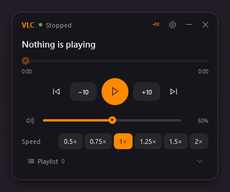
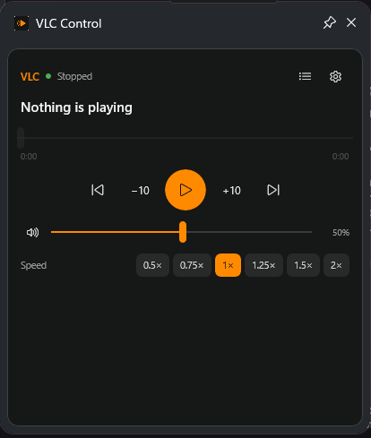
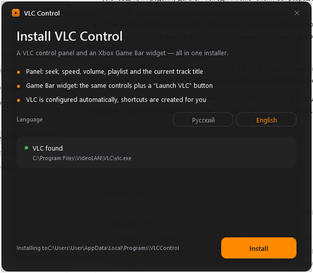
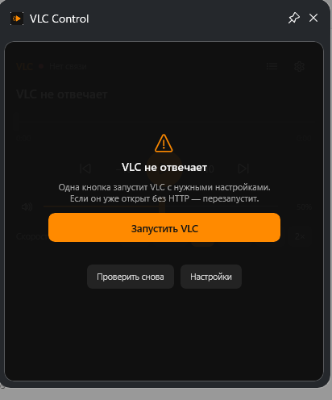

  

<h1 align="center">VLC Control</h1>

  <a href="README.md">English</a> |
  <a href="readme.ru.md">Русский</a>

Control VLC from the <b>Xbox Game Bar</b> (<code>Win+G</code>) or from a standalone panel — speed, seek, volume, playlist and the current track title. One installer does everything.

| Panel | Game Bar widget | Installer |
| --- | --- | --- |
|  |  |  |

## Quick start

1. Download **`VLCControl-Setup.exe`** from the [latest release](https://github.com/bmarcnhii1-max/vlc-gamebar-widget/releases).
2. Run it, pick your language, press **Install**. One UAC prompt — and the panel, the Game Bar widget, the VLC HTTP interface, the shortcuts and the uninstall entry are all in place.
3. Press `Win+G` → widgets icon → **VLC Control** → pin it.

The widget then floats over your game, and the panel is available from the “VLC Control” shortcut on the desktop.

## What you get

- **Panel** (`VlcControl.exe`) — a small always-on-top dark window: track title, seek bar, ±10 s, previous/next, pause, volume, speed (0.5×–2×), playlist, and a **Launch VLC** button that starts or restarts VLC with the right options.
- **Game Bar widget** — the same controls inside the game overlay, plus **Launch VLC**.
- **Installer** — unpacks everything into `%LOCALAPPDATA%\Programs\VLCControl`, registers the widget package, enables developer mode if needed, grants the loopback exemption, backs up and edits `%APPDATA%\vlc\vlcrc`, and creates the shortcuts.

## Requirements

- Windows 10 1903+ or Windows 11
- Xbox Game Bar (built into Windows, `Win+G`)
- VLC 3.x — optional; the installer still sets everything up and offers a download link

## Language

Russian and English are supported everywhere: the installer asks, the panel has a toggle, and the widget has a language picker in its settings. The choice is remembered, and you can switch at any time without reinstalling.

## Uninstall

**Settings → Apps → VLC Control → Uninstall.** The uninstaller removes the widget package, the loopback exemption, the shortcuts and the uninstall entry, and restores developer mode to its previous state.

## Documentation

- [Troubleshooting](docs/TROUBLESHOOTING.md) — what to check when something is not working
- [Building from source](docs/BUILDING.md) — how to build the panel, the widget and the installer
- [How it works](docs/HOW-IT-WORKS.md) — the VLC HTTP protocol and the Game Bar widget plumbing

## License

MIT — see [LICENSE](LICENSE).

Unofficial project, not affiliated with VideoLAN or Microsoft. VLC and Xbox Game Bar are trademarks of their respective owners.
